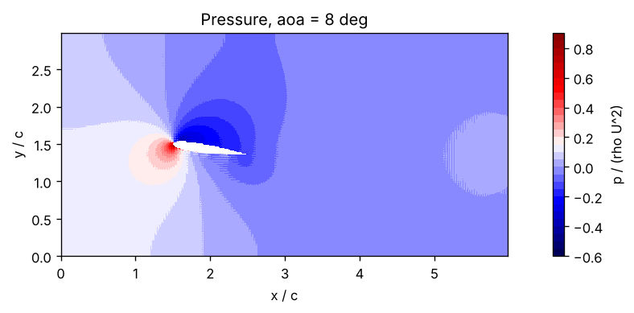

<div align="center">

# Computational Fluid Dynamics — Numerical Experiments

**CFD Course · 7th Semester, Mechanical Engineering Department**  
**Pandit Deendayal Energy University (PDEU), Gandhinagar**  
*Under the guidance of Dr. Anirudh Kulkarni*

</div>

---

> ### Source and attribution
>
> This repository is a derivative of **[Ayush181005/CFD-Lab](https://github.com/Ayush181005/CFD-Lab)** by **Ayush Singh**, used under the MIT License (see [LICENSE](LICENSE)).
>
> The solvers, governing-equation derivations, numerical formulations, and the original result figures in this repository are **Ayush Singh's work**. This copy exists to run the same solvers at different operating points; changes made here are limited to simulation parameters and the regenerated figures that follow from them.

This repository brings together six computational experiments from a **Computational Fluid Dynamics (CFD) course**. The work focuses on translating governing equations into numerical methods, implementing the solvers, and interpreting the resulting flow and thermal fields.

## Experiments at a glance

<table>
  <tr>
    <td width="50%" valign="top">

### 1. 2D Transient Heat Conduction

<a href="2D%20conduction/README.md"></a>

Compare explicit and implicit finite-difference schemes on a square plate, including transient evolution and convergence to steady state.

**Key methods:** Finite Difference Method (FDM), explicit and implicit time integration.

[Open experiment README →](<2D conduction/README.md>)

</td>
    <td width="50%" valign="top">

### 2. Airfoil Flow — Immersed Boundary Method

<a href="airfoil/README.md"></a>

Investigate how angle of attack affects the velocity field, wake development, pressure distribution, and lift and drag trends around a NACA 0012 airfoil.

**Key methods:** Incompressible Navier–Stokes equations, volume penalization, fractional-step projection.

[Open experiment README →](<airfoil/README.md>)

</td>
  </tr>
  <tr>
    <td width="50%" valign="top">

### 3. Centrifugal Pump

<a href="centrifugal pump/README.md"></a>

Model a simplified rotating annular passage to examine temperature distribution, radial pressure rise, velocity components, and pump-head scaling with rotational speed.

**Key methods:** Polar-coordinate governing equations, FDM, Jacobi iteration, grid-refinement checks.

[Open experiment README →](<centrifugal pump/README.md>)

</td>
    <td width="50%" valign="top">

### 4. Transient Couette Flow

<a href="Couette flow/README.md"></a>

Compare explicit and implicit numerical solutions for momentum diffusion between a stationary wall and a moving wall, with emphasis on stability and computational effort.

**Key methods:** Finite Volume Method (FVM), diffusion discretization, Fourier-number stability analysis.

[Open experiment README →](<Couette flow/README.md>)

</td>
  </tr>
  <tr>
    <td width="50%" valign="top">

### 5. Conjugate Heat Transfer

<a href="Heat exchanger/README.md"></a>

Solve heat transfer across a cold stream, a solid wall, and a hot stream using a unified temperature field, then examine the effects of Reynolds number and conductivity ratio.

**Key methods:** FDM, convection–diffusion, fluid–solid thermal coupling.

[Open experiment README →](<Heat exchanger/README.md>)

</td>
    <td width="50%" valign="top">

### 6. Von Kármán Vortex Street

<a href="right cylinder/README.md"></a>

Simulate unsteady flow past a circular cylinder and study alternating vortex shedding, lift oscillations, and the Strouhal number at \(Re = 100\).

**Key methods:** Incompressible Navier–Stokes equations, immersed boundary method, transient flow analysis, FFT.

[Open experiment README →](<right cylinder/README.md>)

</td>
  </tr>
</table>

---

## Numerical methods and concepts

Across the experiments, the work explores:

- **Discretization:** finite difference and finite volume methods.
- **Time integration:** explicit and implicit schemes, including their stability and convergence behaviour.
- **Flow solvers:** pressure correction, continuity enforcement, and immersed-boundary volume penalization.
- **Heat transfer:** transient conduction, convection–diffusion, and conjugate heat transfer.
- **Verification and analysis:** residual monitoring, grid refinement, parameter sweeps, and comparison with expected physical behaviour.
- **Post-processing:** temperature, pressure, velocity and vorticity fields, along with lift, drag, pump head, and heat-transfer metrics.

## Repository structure

Each experiment is maintained in its own folder with its implementation, result figures, and a dedicated README containing the aim, assumptions, governing equations, numerical methodology, results, and conclusion.

```text
.
├── 2D conduction/
├── airfoil/
├── centrifugal pump/
├── Couette flow/
├── Heat exchanger/
├── right cylinder/
├── LICENSE
└── README.md
```

*Folder and image names in this overview are relative paths. If you rename a folder or figure, update the corresponding links above.*

## Note

These are educational numerical models. Their assumptions and limitations are documented in the individual experiment READMEs; results should be interpreted within those modelling choices.

---

<div align="center">

Original work by **Ayush Singh** · Mechanical Engineering · PDEU  
[Ayush181005/CFD-Lab](https://github.com/Ayush181005/CFD-Lab) · MIT License

</div>
